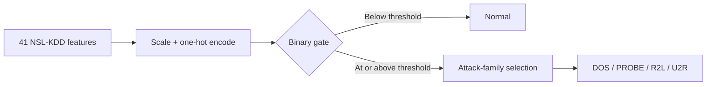
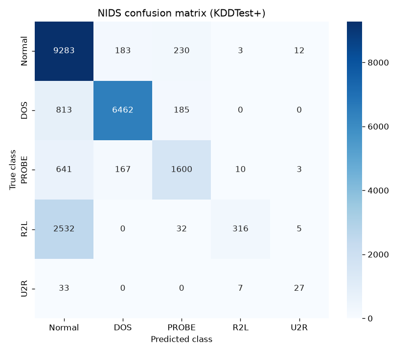

<div align="center">

<h1>🛡️ ML-Based Intrusion Detection</h1>

<p><strong>41 features. Two stages. Five traffic classes.</strong></p>
<p>A PyTorch classifier with a Flask web app for exploring NSL-KDD traffic.</p>

<p>
  
  
  
  
</p>

<p>
  <a href="#quick-start">Quick start</a> ·
  <a href="#try-it-out">Web app &amp; API</a> ·
  <a href="#how-it-works">How it works</a> ·
  <a href="#results">Results</a> ·
  <a href="#live-traffic-pilot">Live pilot</a> ·
  <a href="#troubleshooting">Troubleshooting</a>
</p>

</div>

---

## What it does

Feed in a connection record, get a predicted class, and explore the model scores behind it. Use the browser presets for a quick demo, send JSON through the API, or retrain both networks from scratch.

| Class | What it represents | Example attacks |
| :--- | :--- | :--- |
| 🟢 **Normal** | Benign traffic | — |
| 🔴 **DOS** | Denial of service | `neptune`, `smurf` |
| 🟡 **PROBE** | Scanning and reconnaissance | `satan`, `portsweep` |
| 🟠 **R2L** | Remote-to-local access attempts | `guess_passwd`, `warezmaster` |
| 🟣 **U2R** | User-to-root privilege escalation | `buffer_overflow` |

**Built for learning and research.** The classifier consumes NSL-KDD feature records; live telemetry has its own [pilot workflow](#live-traffic-pilot). Validation accuracy is **99.6%**, while accuracy on the official KDDTest+ set is **80.0%**. The [results](#results) explain that gap.

## Quick start

Run these commands from the project root. The repository includes trained model artifacts, so you can try the app before downloading data or training.

### 1. Create a virtual environment

```bash
python -m venv .venv
```

Activate it using the command for your shell:

| Shell | Command |
| :--- | :--- |
| Windows PowerShell | `.\.venv\Scripts\Activate.ps1` |
| Windows Command Prompt | `.venv\Scripts\activate.bat` |
| macOS / Linux | `source .venv/bin/activate` |

### 2. Install and launch

```bash
python -m pip install -r requirements.txt
python app/app.py
```

### 3. Open the app

Visit **[localhost:5000](http://localhost:5000)**, choose a sample preset, and click **Analyze Traffic**.

<details>
<summary><strong>Want to train it yourself?</strong></summary>

Run the complete download → preprocess → train → evaluate pipeline:

```bash
python run_all.py
python app/app.py
```

Or run the stages separately:

```bash
python data/download_data.py
python -m src.train
python -m src.evaluate
```

Training runs preprocessing automatically when the processed split is missing or outdated. Evaluation writes [metrics](reports/metrics.json) and a [confusion matrix](reports/confusion_matrix.png).

| Output | Location |
| :--- | :--- |
| Raw dataset | `data/KDDTrain+.txt`, `data/KDDTest+.txt` |
| Processed splits | `data/processed/dataset.npz` |
| Model checkpoints | `models/binary_model.pt`, `models/multiclass_model.pt` |
| Preprocessing artifacts | `models/scaler.pkl`, `models/encoder.pkl`, `models/label_encoder.pkl` |
| Feature schema and selected threshold | `models/metadata.json` |

If the download mirrors are unavailable, place `KDDTrain+.txt` and `KDDTest+.txt` in `data/` manually, then run training and evaluation.

</details>

<details>
<summary><strong>Using a CPU-only PyTorch build</strong></summary>

Install the pinned CPU build before installing the remaining requirements:

```bash
python -m pip install torch==2.13.0 --index-url https://download.pytorch.org/whl/cpu
python -m pip install -r requirements.txt
```

</details>

## Try it out

### In the browser

1. Pick **Normal**, **DOS**, **PROBE**, **R2L**, or **U2R** to fill in a sample record, or enter the 41 features yourself.
2. Click **Analyze Traffic**.
3. Inspect the predicted class, confidence bar, binary attack score, and per-class scores.

Confidence and probability fields are **uncalibrated model scores**. A Normal prediction can still miss an attack.

### Through the JSON API

Send a feature object to `POST /api/predict`. The endpoint accepts either `{"features": {...}}` or a bare feature object. Missing numeric fields default to `0`; missing categorical fields use the first category stored in the model metadata.

```bash
curl -X POST http://localhost:5000/api/predict \
  -H "Content-Type: application/json" \
  -d '{"features":{"protocol_type":"tcp","service":"private","flag":"S0","src_bytes":0,"dst_bytes":0,"count":123,"srv_count":6,"serror_rate":1.0,"srv_serror_rate":1.0,"dst_host_serror_rate":1.0}}'
```

<details>
<summary><strong>PowerShell equivalent</strong></summary>

```powershell
$body = @{
    features = @{
        protocol_type = "tcp"
        service = "private"
        flag = "S0"
        src_bytes = 0
        dst_bytes = 0
        count = 123
        srv_count = 6
        serror_rate = 1.0
        srv_serror_rate = 1.0
        dst_host_serror_rate = 1.0
    }
} | ConvertTo-Json

Invoke-RestMethod -Uri "http://localhost:5000/api/predict" `
    -Method Post -ContentType "application/json" -Body $body
```

</details>

Illustrative response; scores depend on the input and saved model artifacts:

```json
{
  "predicted_class": "DOS",
  "is_attack": true,
  "confidence": 0.99,
  "attack_probability": 0.99,
  "class_probabilities": {
    "Normal": 0.003,
    "DOS": 0.99,
    "PROBE": 0.004,
    "R2L": 0.002,
    "U2R": 0.001
  }
}
```

| Route | Purpose |
| :--- | :--- |
| `GET /` | Browser input form |
| `POST /predict` | Form prediction and result page |
| `POST /api/predict` | JSON prediction |
| `GET /health` | Model readiness; returns `503` if artifacts are missing or fail to load |

Invalid JSON shapes or feature values return `400`. Authentication failures return `401`, and requests over the configured limit return `429`.

## How it works



**Stage 1 answers “is this an attack?”** A binary neural network produces an attack score. The threshold controls the tradeoff between detection and false alarms.

**Stage 2 chooses the attack family.** The multiclass network is trained on all five classes. When the binary gate flags a record, inference selects the highest-scoring attack class and ignores the Normal output.

The saved `StandardScaler` and `OneHotEncoder` are reused for validation, test data, and serving. Both are fitted only on the training partition.

<details>
<summary><strong>Dataset and feature encoding</strong></summary>

NSL-KDD is an academic intrusion-detection benchmark derived from KDD Cup '99 with redundant records removed.

| Class | KDDTrain+ | Share | KDDTest+ | Share |
| :--- | ---: | ---: | ---: | ---: |
| Normal | 67,343 | 53.46% | 9,711 | 43.08% |
| DOS | 45,927 | 36.46% | 7,460 | 33.09% |
| PROBE | 11,656 | 9.25% | 2,421 | 10.74% |
| R2L | 995 | 0.79% | 2,885 | 12.80% |
| U2R | 52 | 0.04% | 67 | 0.30% |
| **Total** | **125,973** | | **22,544** | |

The training set contains roughly **1,295 Normal records for every U2R record**. Inverse-frequency class weights help the multiclass model account for rare classes.

KDDTest+ has a different class distribution and includes attack subtypes absent from training. R2L grows from **0.79%** of training records to **12.80%** of test records, making performance on that family especially consequential.

Each connection has **38 numeric features**, standardized with z-scores, and **3 categorical features**: `protocol_type`, `service`, and `flag`. The included encoder expands those categories into **84 columns**, yielding a **122-dimensional** model input.

</details>

<details>
<summary><strong>Model architecture and training settings</strong></summary>

| Setting | Binary classifier | Multiclass classifier |
| :--- | :--- | :--- |
| Layers | `122 → 128 → 64 → 32 → 1` | `122 → 256 → 128 → 64 → 5` |
| Activation | ReLU | ReLU |
| Dropout | `0.3 / 0.2 / 0.0` | `0.4 / 0.3 / 0.2` |
| Batch normalization | None | First hidden layer |
| Loss | `BCEWithLogitsLoss` with `pos_weight` | Inverse-frequency weighted `CrossEntropyLoss` |

Default training settings in [config.yaml](config.yaml):

- **Split:** stratified 85/15 train/validation split of KDDTrain+; seed `42`.
- **Optimizer:** Adam, learning rate `1e-3`, weight decay `1e-4`.
- **Schedule:** `StepLR`, multiplying the learning rate by `0.5` every 15 epochs.
- **Batch size:** `256`, up to `60` epochs, with early stopping after `10` epochs without validation-loss improvement.
- **Device:** automatic CPU/CUDA selection.
- **Threshold:** maximize validation F2 while keeping validation false alarms at or below `1%`.

Model fitting and threshold selection do not use KDDTest+. Validation contains only **149 R2L** and **8 U2R** records, so a few changed predictions can move rare-class metrics substantially.

</details>

## Results

The saved [metrics report](reports/metrics.json) covers two evaluation settings: held-out rows from KDDTrain+ and the official KDDTest+ set, which includes unseen attack subtypes.

| Metric | Validation · 18,896 records | KDDTest+ · 22,544 records |
| :--- | ---: | ---: |
| **Five-class accuracy** | **99.6%** | **80.0%** |
| Binary accuracy | 99.6% | 81.7% |
| Attack detection rate / recall | 99.8% | 70.2% |
| Attack precision | 99.3% | 96.8% |
| False-alarm rate | 0.6% | 3.1% |
| Binary ROC-AUC | 0.9999 | 0.9399 |

**R2L is the biggest weak spot.** Its recall drops from **96.6%** on validation to **14.4%** on KDDTest+. Of the **2,885** R2L test records, **2,431** are classified as Normal. The aggregate accuracy does not capture the severity of those misses.



<details>
<summary><strong>Per-class F1 scores</strong></summary>

| Class | Validation F1 | KDDTest+ F1 | Change |
| :--- | ---: | ---: | ---: |
| 🟢 Normal | 0.996 | 0.820 | −0.176 |
| 🔴 DOS | 0.999 | 0.915 | −0.084 |
| 🟡 PROBE | 0.991 | 0.750 | −0.241 |
| 🟠 R2L | 0.892 | **0.249** | **−0.643** |
| 🟣 U2R | 0.737 | 0.529 | −0.208 |

The included validation-selected attack threshold is approximately `0.249`. Changing it trades recall against false alarms; it does not resolve the generalization gap for unseen R2L attacks.

</details>

<details>
<summary><strong>R2L diagnostics and experiments</strong></summary>

After preprocessing and training, regenerate the subtype-level error analysis:

```bash
python -m src.r2l_diagnostics
```

The [R2L report](reports/r2l_diagnostics.md) and [JSON results](reports/r2l_diagnostics.json) separate binary-gate misses from attack-family mistakes. These are evaluation tools; do not choose models or thresholds using KDDTest+ outcomes.

The [R2L-weighted gate experiment](experiments/r2l_weighted_gate.py) tested a candidate gate with the same multiclass model. Its [saved results](experiments/r2l_weighted_gate_results.json) show KDDTest+ R2L recall increasing from **14.4% to 17.5%**, while most R2L attacks remain missed.

The candidate is not deployed. In the [held-out subtype check](experiments/subtype_holdout_results.json), excluding `warezclient` from fitting and threshold selection left the candidate detecting **0 of 890** examples; a freshly trained baseline gate detected **25**. The [reproducible check](experiments/subtype_holdout.py) uses KDDTrain+ only.

</details>

Regenerate the metrics and confusion matrix with `python -m src.evaluate`.

## Live traffic pilot

The separate `live_ids` package supports Zeek JSON `conn.log` records and a minimized Windows Security **4625** export. It replays a provisional rule: **four failed logons in a rolling hour**. Candidate alerts are observation-only and never block a sign-in.

| Guide | Start here if… |
| :--- | :--- |
| [Implementation manual](docs/live_ids_manual.md) | You want the full live-traffic pilot workflow |
| [Windows PC procedure](docs/windows_pc_pilot.md) | You are testing on your own Windows PC |
| [Live data contract](docs/live_data_schema.md) | You need the supported fields and limitations |

From an elevated PowerShell window, export the minimized authentication data and replay it:

```powershell
.\scripts\export_windows_auth.ps1
.\.venv\Scripts\python.exe -m live_ids replay --auth "$env:USERPROFILE\nids-pilot\auth_failures_7d.csv"
```

Use `--labels` for a locally reviewed `record_id,label` CSV. Add `--conn` and `--capture-id` for a Windows-accessible Zeek JSON `conn.log`. The replay prints aggregate counts and candidate-alert metadata without account names or IP addresses.

For a bounded **10-minute** live check, run `.\scripts\watch_windows_auth.ps1` in elevated PowerShell. Pilot data and alerts stay under `%USERPROFILE%\nids-pilot`, outside Git.

These live records are not passed to the NSL-KDD classifier or classified as attacks. A live ML model and validated attack recall still require labeled attack scenarios.

## Project layout

```text
.
├── app/                 Flask routes, form parsing, model access
├── src/                 Feature schema, preprocessing, training, inference
├── live_ids/            Zeek and Windows authentication pilot tools
├── templates/           Input form and prediction results (Jinja2)
├── static/              CSS and JavaScript, including sample presets
├── data/                Dataset downloader and local dataset files
├── models/              Included checkpoints and preprocessing artifacts
├── reports/             Saved metrics, confusion matrix, R2L diagnostics
├── experiments/         Alternative gate and subtype holdout checks
├── notebooks/EDA.ipynb  Exploratory data analysis
├── scripts/             Windows export, capture, and watch helpers
├── docs/                Pilot guides and live data contract
├── tests/               API, pipeline, diagnostics, and pilot tests
├── config.yaml          Paths, hyperparameters, threshold settings
├── requirements.txt     Dependencies
└── run_all.py           Download → preprocess → train → evaluate
```

## Configuration and deployment

All model and pipeline settings live in [config.yaml](config.yaml). Retrain after changing training settings; rerun `python -m src.preprocess` before training if you change encoding, scaling, or split settings. A numeric `inference.attack_threshold` override requires an app restart.

For serving with a WSGI server:

| Platform | Command |
| :--- | :--- |
| Linux / macOS | `gunicorn -w 4 -b 0.0.0.0:5000 app.app:app` |
| Windows | `python -m waitress --port=5000 app.app:app` |

Models are cached once per worker. The Flask development server binds to `127.0.0.1` by default; `HOST` and `PORT` can change its bind address.

### Endpoint access

Set an API key before exposing the app on a network:

| Environment variable | Behavior | Default |
| :--- | :--- | :--- |
| `NIDS_API_KEY` | API requests require `X-API-Key`; browser access supports HTTP Basic with username `nids` and the key as password | Unset; access is open |
| `NIDS_RATE_LIMIT` | Requests per minute per peer IP, per worker, on browser and inference routes; `0` disables the limit | `120` |

```powershell
$env:NIDS_API_KEY = "your-secret"
$env:NIDS_RATE_LIMIT = "60"
python app/app.py
```

On macOS/Linux, use `NIDS_API_KEY=your-secret NIDS_RATE_LIMIT=60 python app/app.py`. For authenticated API calls, add `-H "X-API-Key: your-secret"` to the curl command or `-Headers @{"X-API-Key" = "your-secret"}` to the PowerShell request.

Use TLS for credentials and configure request limits at the network edge. The built-in limiter is local to each worker, and the app ignores client-supplied `X-Forwarded-For`; configure trusted proxy handling at the deployment boundary if you need the original client IP.

Checkpoints use `torch.load(..., weights_only=True)`. Preprocessing `.pkl` files are loaded with `joblib` and must come from a trusted source, since loading an untrusted pickle can execute code.

## Tests

```bash
python -m pytest -q
```

The suite covers API behavior, preprocessing and inference, R2L diagnostics, and live-pilot parsing and replay. Endpoint tests also check the graceful `503` response when model artifacts are missing.

## Troubleshooting

<details>
<summary><strong>Predictions return <code>503 models_not_trained</code></strong></summary>

Check `GET /health` for `missing_artifacts`. Run `python -m src.train` to regenerate missing model files. If files exist but health still returns `503`, check the server logs for the model-loading error and use the pinned dependencies in [requirements.txt](requirements.txt).

</details>

<details>
<summary><strong>Gunicorn fails with <code>No module named 'fcntl'</code></strong></summary>

Use Waitress on Windows:

```bash
python -m waitress --port=5000 app.app:app
```

</details>

<details>
<summary><strong>A NumPy array-shape deprecation warning appears</strong></summary>

The documented warning occurs in joblib's pickle-loading path. Retraining alone does not remove it. Use the pinned NumPy, scikit-learn, and joblib versions in [requirements.txt](requirements.txt), and retrain artifacts when changing those dependencies.

</details>

<details>
<summary><strong><code>KDDTrain+.txt</code> or <code>KDDTest+.txt</code> is missing</strong></summary>

Run `python data/download_data.py`. If the mirrors are unavailable, place both dataset files in `data/` manually.

</details>

<details>
<summary><strong>Changes to <code>config.yaml</code> do not take effect</strong></summary>

Training reuses `data/processed/dataset.npz` when its split arrays are available. After changing preprocessing or split settings, rebuild it with `python -m src.preprocess`, then train again. Restart the app after changing an inference threshold or environment variable.

</details>

---

<p align="center"><strong>Explore the model. Inspect the misses. Keep the benchmark in context.</strong></p>

NSL-KDD is an academic benchmark. Modern live detection needs current traffic, online feature extraction, and validation on labeled scenarios. Use this project for education and research; it should not be the sole means of intrusion detection.
